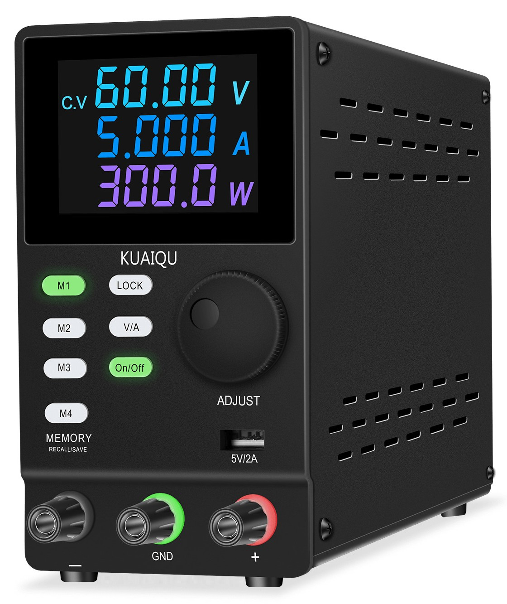

# KUAIQU-NICE-POWER SPPS3010D - Product Documentation

This document describes the KUAIQU-NICE-POWER SPPS3010D programmable DC power
supply: what it is, its interfaces, its specifications, and how it is controlled
in software. It is the product reference that accompanies this repository's
controller ([`scripts/kuaiqus_psu.ps1`](../scripts/kuaiqus_psu.md)).

> **Sourcing note.** The hardware details and the communication protocol
> documented here were gathered from various sources and forums around the web,
> because the published information is scarce and inconsistent, and were
> confirmed by bench testing where noted. Treat them as community knowledge
> rather than official manufacturer specifications.

## Identification

| Field | Value |
| --- | --- |
| Manufacturer | KUAIQU-NICE-POWER (Shenzhen Borui Communication Technology Co., Ltd.) |
| Series | SPPS - programmable regulated DC power supply |
| Model | SPPS3010D |
| Interface variants | Sold as USB / RS232 / RS485; the `SPPS-D3010-232` and `SPPS-D3010-485` names appear online but are unconfirmed |
| Firmware | `V1.3` (read via the serial protocol; see below) |

> **Model naming.** The `3010` in the model number is the conventional Chinese
> bench-supply shorthand for a **30 V / 10 A** output, which is confirmed by the
> vendor listing and the product's "Memory Type" classification.

## Product images



## Key specifications

Specifications marked *verified* were confirmed by driving a real unit; those
marked *unconfirmed* or *nominal* come from the model designation or from
unverified online sources and must be confirmed on the panel/rating label or
against the actual hardware.

| Parameter | Value | Source |
| --- | --- | --- |
| Output voltage | 0-30 V | *verified* (30 V / 10 A class) |
| Output current | 0-10 A | *verified* (30 V / 10 A class) |
| Interface | RS232, USB (CP2102 bridge), RS485 | RS232/USB *verified*; RS485 *unconfirmed* |
| Serial protocol | ASCII, `<` ... `>` framed | *verified* |
| Baud rate | 1200 / 2400 / 4800 / 9600 / 19200, default **9600** | *verified* |
| Framing | 8 data bits, no parity, 1 stop bit (8N1) | *verified* |
| Firmware version | `V1.3` | *verified* (read on-device) |
| Remote commands | set/read voltage, set/read current, power on/off, firmware version | *verified* |

## Interfaces

The instrument was sold as supporting three physical communication paths to a
computer: **USB, RS232, and RS485** (presumably one at a time).

| Interface | Status | Notes |
| --- | --- | --- |
| **USB** | *confirmed* | A Silicon Labs **CP2102** USB-to-UART bridge (`VID 10C4`, `PID EA60`). Requires the Silicon Labs CP210x driver on Windows; appears as a COM port (e.g. `COM7`), a `/dev/serial/by-id` path on Linux, or `/dev/cu.*` on macOS. |
| **RS232** | *confirmed* | Standard serial port; from software it is identical to a COM port. |
| **RS485** | *unconfirmed* | The unit was sold as RS485-capable, but the RS485 wiring is not documented. Online mentions say a unit is bought configured for USB/RS232 or USB/RS485, and other products in the series expose a dedicated 3-pin RS485 header beside the USB and RS232 ports. Treat any RS485 detail as unverified. |

RS232 and USB speak the same ASCII protocol (8N1, 9600 baud default) and look
like a plain serial COM port to software; the RS485 path is assumed to do the
same but is unconfirmed. See [USB driver setup](#usb-driver-setup).

RS232 and USB are confirmed; the RS485 interface is **unconfirmed**. The exact
connector, pinout, and whether a unit must be ordered specifically as RS485
(rather than RS232) are all unclear - the documentation online is scarce and
inconsistent. Some listings describe separate USB/RS232 and USB/RS485 versions,
and other products in the series provide a dedicated 3-pin RS485 header next to
the USB and RS232 ports. Wire RS485 only after verifying your own unit.

### DB9 pin-out

> **RS485 caution.** Everything below about RS485 is unconfirmed and drawn from
> scarce, inconsistent online mentions. Verify the pinout and configuration of
> your exact unit before connecting an RS485 bus. The RS232 and USB information
> is bench-confirmed.

| DB9 pin | RS-232 (confirmed) | RS-485 (unconfirmed) |
| --- | --- | --- |
| 1 | No connection | No connection |
| 2 | RXD (Receive Data In) | No connection |
| 3 | TXD (Transmit Data Out) | No connection |
| 4 | No connection | A / Data+ (non-inverting line) |
| 5 | GND (signal ground reference) | GND (optional shield / signal ground) |
| 6 | No connection | No connection |
| 7 | No connection | B / Data- (inverting line) |
| 8 | No connection | No connection |
| 9 | No connection | No connection |

- **Pins 1, 6, 8, and 9** have no internal trace connections on the RS232/USB
  unit.
- **RS-232 (confirmed)** uses the standard DB9 signal assignments (pin 2 = RxD,
  pin 3 = TxD, pin 5 = GND), so a straight-through 3-wire DB9 cable connects it
  directly to a PC COM port (TxD is the supply's output, RxD its input).
- **RS-485 (unconfirmed)** is commonly cited as pin 4 = A (Data+) and pin 7 =
  B (Data-), with A and B matching polarity on both ends of the bus and pin 5 as
  the common/shield ground, but no vendor documentation confirms this. Verify
  before use.

## Communication protocol

The full wire protocol is documented in
[`scripts/kuaiqus_psu_protocol.md`](../scripts/kuaiqus_psu_protocol.md). Highlights:

- Frames are ASCII lines `<` + 11 characters + `>`.
- Values are encoded in **millivolts** (voltage) and **milliamperes** (current),
  six digits with three `000` padding characters.
- Function codes: `1` set voltage, `2` read voltage, `3` set current, `4` read
  current, `6` read firmware version, `7` power on, `8` power off, `9`
  connect/disconnect. Code `5` is unused.
- Set commands acknowledge with `<11OK0000000>` / `<13OK0000000>`.

## Software control

This repository provides:

- A non-blocking PowerShell CLI (Windows/Linux/macOS) -
  [`scripts/kuaiqus_psu.ps1`](../scripts/kuaiqus_psu.md).
- A persistent Python backend that owns the serial port -
  [`scripts/kuaiqus_psu_backend.py`](../scripts/kuaiqus_psu_backend.md).
- An MCP stdio server - [`scripts/kuaiqus_psu_mcp.py`](../scripts/kuaiqus_psu_mcp.py).
- Built-in port discovery - `-ListPorts [-Probe]` on the CLI.

Quick start:

```powershell
.\scripts\kuaiqus_psu.ps1 -ListPorts -Probe    # find and confirm the CP2102 port
.\scripts\kuaiqus_psu.ps1 -Connect -Port COM7  # start backend, lock the front panel
.\scripts\kuaiqus_psu.ps1 -Get                 # read voltage/current/state
.\scripts\kuaiqus_psu.ps1 -Disconnect          # stop backend, unlock the front panel
```

## USB driver setup

The USB interface is a CP2102 bridge, not a CDC class device, so Windows lists it
under *Other Devices* until the Silicon Labs CP210x driver is installed. See
[windows.md](windows.md) for the full walkthrough and [macos.md](macos.md) for
macOS device naming.

1. Download **"CP210x Universal Windows Driver"** from
   `https://www.silabs.com/developers/usb-to-uart-bridge-vcp-drivers` and extract.
2. Install via **Device Manager** (right-click the device -> *Update driver* ->
   *Browse my computer* -> select the extracted folder) or, from an admin shell:
   `pnputil /add-driver <extracted>\silabser.inf /install`.
3. The device then appears under *Ports (COM & LPT)* as
   `Silicon Labs CP210x USB to UART Bridge (COMx)`.

## Safety

- The unit sources real DC power. Before enabling the output, set the voltage and
  the current limit deliberately and connect the load correctly.
- The output ramps on a soft-start after enable and, with no load, discharges
  slowly when the setpoint is lowered - allow it to settle before asserting a
  value.

## Related documentation

- [Protocol reference](../scripts/kuaiqus_psu_protocol.md)
- [CLI reference](../scripts/kuaiqus_psu.md)
- [Backend contract](../scripts/kuaiqus_psu_backend.md)
